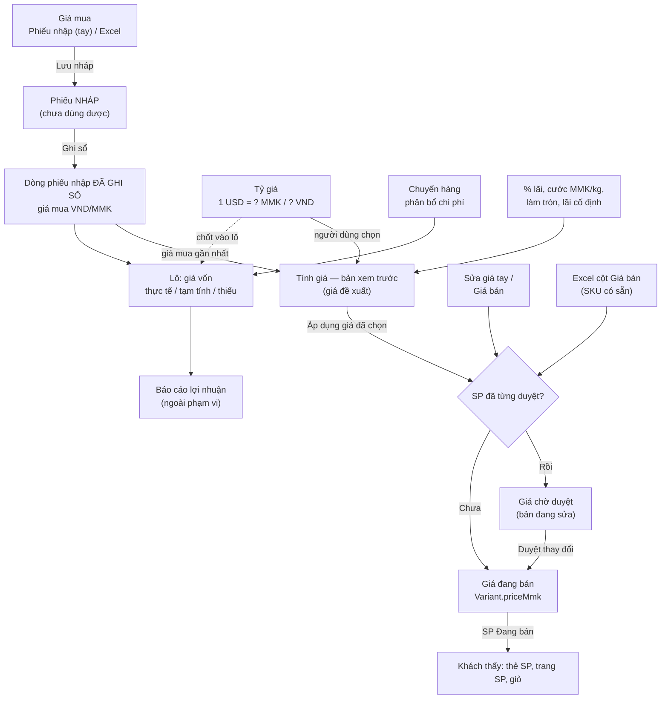

# Báo cáo luồng giá: từ nhập hàng đến giá khách thấy trên web

Ngày 15/11/2026 · Phạm vi: nhập sản phẩm/nhập hàng (tay và Excel) → giá mua → tỷ giá → giá vốn và chi phí về kho → công thức giá bán → giá đề xuất → chờ duyệt → giá khách thấy (trang sản phẩm, thẻ, giỏ). Đơn hàng, hoa hồng và lợi nhuận **ngoài phạm vi** (xem `docs/bao-cao-kiem-tra-gia-2026-11-08.md`).

Chỉ khảo sát. **Không sửa code, cấu hình hay dữ liệu vận hành; không commit; không deploy.** Kiểm thử chạy trên DB **`glow_test`** bằng file test tạm, đã xoá sau khi chạy.

Nhãn bằng chứng:
- **[KC]** = đã kiểm chứng bằng chạy hàm nghiệp vụ thật trên `glow_test`.
- **[ĐM]** = xác nhận bằng đọc mã (có file:dòng).
- **[SL]** = suy luận, chưa chạy.

---

## 1. Trả lời nhanh

**Nhập trực tiếp giá bán có bỏ qua công thức không? — Có, bỏ qua hoàn toàn.** [KC]
- **Sửa giá tay** (bước 3 trang SP, hoặc trang **Giá bán**) và cột **Giá bán (MMK)** trong Excel ghi thẳng con số bạn gõ.
- Không so với giá vốn, không làm tròn bội số 100, không cảnh báo lãi thấp.
- Hệ thống chỉ kiểm: giá ≥ 1, có **lý do** (riêng sửa tay), hoa hồng CTV ≤ giá.
- Ví dụ đã chạy: công thức ra 26.000 nhưng sửa tay **22.050** (thấp hơn, không tròn 100) vẫn được chấp nhận và lên web sau khi duyệt.

**Đổi tỷ giá hoặc giá vốn có tự đổi giá trên web không? — Không.** [KC]
- Thêm tỷ giá mới, ghi sổ phiếu nhập giá mới, phân bổ chi phí chuyến hàng: giá web **giữ nguyên**.
- Hệ thống chỉ bật cảnh báo trên trang SP: "Có tỷ giá mới hơn lần đổi giá gần nhất — nên tính lại giá" hoặc "Có phiếu nhập mới sau lần đặt giá gần nhất — nên tính lại giá".
- Muốn đổi giá phải tự chạy **Tính giá** rồi áp dụng (và duyệt nếu SP đã duyệt).

**5 điều cần nhớ**
1. Giá khách thấy chỉ lấy từ **một cột duy nhất**: giá đang bán của biến thể (`Variant.priceMmk`). [ĐM]
2. Công thức giá bán (kho nhập VN) dùng **giá mua VND của phiếu nhập đã ghi sổ gần nhất**, **không** dùng giá vốn lô hay chi phí chuyến hàng. Giá vốn chỉ phục vụ báo cáo lợi nhuận. [KC]
3. **Phiếu nhập nháp** (kể cả phiếu Excel tạo ra) **không** được dùng để tính giá — phải **Ghi sổ** trước. [KC]
4. SP **chưa từng duyệt**: áp giá là ghi thẳng (nhưng khách chưa thấy vì SP chưa đăng). SP **đã duyệt**: mọi cách đổi giá chỉ tạo **giá chờ duyệt**; khách vẫn thấy giá cũ đến khi **Duyệt thay đổi**. [KC]
5. Tỷ giá trong **Tính giá** do người dùng **chọn** (có thể chọn tỷ giá cũ); cước MMK/kg là **số gõ tay** mỗi lần tính. [KC]

---

## 2. Sơ đồ

Bản chữ:
- **Nhánh giá bán:** phiếu nhập đã ghi sổ → (giá mua gần nhất) + tỷ giá chọn + % lãi + cước/kg → giá đề xuất → áp dụng → (SP chưa duyệt: giá đang bán) hoặc (SP đã duyệt: giá chờ duyệt → duyệt → giá đang bán) → web.
- **Đường tắt:** sửa tay / Excel → (chưa duyệt: giá đang bán) hoặc (đã duyệt: giá chờ duyệt). Không qua công thức.
- **Nhánh giá vốn** (lô, tỷ giá chốt, chuyến hàng) đi riêng sang báo cáo, **không** quay lại giá bán.

---

## 3. Từng bước

### B1. Giá mua

| Mục | Nội dung |
|---|---|
| Lấy từ đâu | Phiếu **Nhập kho** (form 2 bước, có **Dán từ Excel**) hoặc file Excel sản phẩm (cột **Giá mua/đv**, kèm **Số lượng nhập**) |
| Ai nhập | Người nhập kho (Quản trị viên, Quản lý kho); Excel: Quản trị viên |
| Loại tiền | Theo kho của SP: kho **Hàng nhập VN** → VND; kho **Hàng mua MMK** → MMK. Mỗi lô chỉ một loại tiền |
| Lưu ở đâu | Từng dòng phiếu (`StockDocumentLine.unitCostVnd/Mmk`) và lô (`Batch.unitCost*` = bình quân theo SL đã nhập) |
| Thời điểm có hiệu lực | Khi phiếu được **Ghi sổ**. Phiếu nháp không được dùng để tính giá |
| Bắt buộc? | Bắt buộc nếu muốn dùng **Tính giá** (thiếu → dòng bị bỏ qua "Thiếu giá mua đã ghi sổ"). Không bắt buộc nếu bạn đặt giá tay |
| Nhánh | Excel có số lượng → phiếu **nháp**, phải mở phiếu và **Ghi sổ** |

Bằng chứng:
- Chỉ đọc phiếu `RECEIVE` đã `POSTED`, sắp theo ngày ghi sổ mới nhất (`src/server/pricing/cost.ts:46,49`) [ĐM].
- Khi phiếu còn nháp, chạy Tính giá báo "Không có biến thể nào đủ dữ liệu để tính giá…" [KC].

### B2. Tỷ giá

| Mục | Nội dung |
|---|---|
| Lấy từ đâu | **Giá & tỷ giá › Tỷ giá**: nhập 1 USD = ? MMK và 1 USD = ? VND; hệ thống tự tính MMK cho 1 VND (`formula.ts:35-58`) |
| Ai nhập | Quản trị viên. Chỉ thêm, **không sửa/xoá** |
| "Tỷ giá đang dùng" | Bản mới nhất theo thời điểm hiệu lực (`latest-rate.ts:9`) |
| Dùng cho giá vốn | Chốt vào lô: phiếu tay chốt **lúc Ghi sổ** (`documents.ts:457-459`) [KC]; Excel chốt **lúc Xác nhận nhập** (`catalog-import.ts:547-552`) [ĐM] |
| Dùng cho giá bán | **Không tự động.** Người dùng **chọn** tỷ giá khi chạy Tính giá; máy chủ nhận **bất kỳ** tỷ giá nào còn lưu (`runs.ts:249`) [KC] |
| Khi nào tính lại | Khi trang SP báo "Có tỷ giá mới hơn…" (chỉ kho nhập VN, `readiness.ts:118`) |

### B3. Giá vốn và chi phí về kho

| Loại | Cách có | Công thức |
|---|---|---|
| **Thực tế** | Phân bổ chuyến hàng (**Phân bổ giá vốn**), hoặc cột Excel **Phí đưa về kho** (có số khác 0) | (giá mua + chi phí/đv) × tỷ giá lô |
| **Tạm tính** | Phiếu nhập có **Cước tạm tính VN → MM (MMK/kg)** | giá mua × tỷ giá lô + cước/kg × khối lượng (`documents.ts:500-511`) |
| **Thiếu** | Không có hai loại trên | — |
| Kho MMK | Luôn thực tế = giá mua MMK | — |

**Quan trọng:** giá vốn **không** đi vào công thức giá bán của kho nhập VN. Công thức dùng `unitCostVnd` của dòng phiếu (basis "PURCHASE", `pricing/cost.ts:68`). Ví dụ đã chạy: phân bổ chuyến làm giá vốn lô 17.800 → 17.850 MMK nhưng giá bán vẫn 24.600 [KC].

Bắt buộc? Không, đối với giá bán. Thiếu giá vốn chỉ hiện lưu ý "Tồn bán thiếu giá vốn" và làm báo cáo lợi nhuận sai.

### B4. Công thức giá bán

| Kho | Công thức | Nguồn |
|---|---|---|
| **Hàng nhập VN** | giá mua VND (phiếu đã ghi sổ gần nhất) × tỷ giá **đã chọn** × (1 + % lãi) + cước MMK/kg × khối lượng (g) ÷ 1000, **làm tròn lên** bội số | `formula.ts:105-120` |
| **Hàng mua MMK** | giá mua MMK (phiếu đã ghi sổ gần nhất) + **lãi cố định** của SP, làm tròn lên | `formula.ts:123-128` |
| **Combo** | tổng giá mua thành phần × SL; khối lượng = của combo hoặc tổng thành phần | `pricing/cost.ts:80-90`, `runs.ts:194-196` |

- % lãi chỉ tính trên tiền hàng, không tính trên cước.
- Tính bằng số nguyên chính xác rồi làm tròn **một lần** ở cuối.
- **% lãi**, **cước/kg**, **làm tròn** là ô **gõ tay** mỗi lần tính. Cước/kg mặc định lấy từ lần tính trước (mọi kho) (`pricing/queries.ts:119`). Làm tròn mặc định theo cài đặt (100).
- **Lãi cố định** (kho MMK) đặt ở bước 3 **Sửa giá tay**. Thiếu → dòng bị bỏ qua [KC].

### B5. Giá đề xuất (bản xem trước)

| Mục | Nội dung |
|---|---|
| Cách tạo | **Giá & tỷ giá › Tính giá** hoặc **Tính giá SP này** / **Tính giá SKU vừa nhập** |
| Lưu ở đâu | Một lần tính (`PriceUpdateRun`) + các dòng (`PriceRunLine`): giá cũ, giá mới, giá mua, cước |
| Ảnh hưởng | **Không đổi giá đang bán** (đã kiểm: giá web vẫn 10.000 sau khi xem trước) [KC] |
| Dòng bị bỏ qua | Thiếu giá mua đã ghi sổ / thiếu khối lượng / thiếu lãi cố định / giá ra 0 (`runs.ts:163,186,198,226`) |
| Cảnh báo | Đổi ≥ 20%; lãi minh hoạ ≤ 5% giá (giả định mọi đơn trả hoa hồng CTV mặc định + tầng trên, `risks.ts:14-17`) — chỉ cảnh báo, không chặn |
| Hạn | 3 ngày (cài đặt). Khi áp, hệ thống tính lại; đầu vào đổi thì bỏ qua dòng ("Đầu vào đã đổi…") (`runs.ts:318,351`) |

### B6. Chờ duyệt

| Trạng thái SP | Bảng tính giá | Sửa giá tay | Excel |
|---|---|---|---|
| **Chưa từng duyệt** | Ghi thẳng giá đang bán (`runs.ts:371`) | Ghi thẳng (`product-pricing.ts:81`) | Ghi thẳng (`products.ts:238`) |
| **Đã duyệt** | Vào **giá chờ duyệt** (`runs.ts:363`) | Vào giá chờ duyệt (`product-pricing.ts:66`) | Vào giá chờ duyệt (`change-request.ts:153-165`) |

- SP chưa duyệt bị ghi thẳng giá, nhưng khách **chưa thấy** vì SP chưa đăng. Đã kiểm: sau khi áp, trang SP "không hiển thị" [KC].
- Giá chờ duyệt thành giá đang bán **chỉ khi duyệt** (`change-request.ts:237`).
- **Lịch sử giá** của SP đã duyệt được ghi **lúc duyệt** (`change-request.ts:239`). Người ghi là người đề xuất, không phải người duyệt.
- Tuỳ chọn **Gửi duyệt ngay** / **Duyệt luôn** khi áp bảng giá hoặc nhập Excel. "Duyệt luôn" duyệt **cả bản đang sửa** của SP, không chỉ phần giá.

### B7. Giá khách thấy

- **Điều kiện hiển thị:** SP đang đăng và chưa ngừng kinh doanh (`store-visibility.ts:8`); chỉ biến thể đang dùng.
- **Thẻ SP / danh sách:** giá **nhỏ nhất** trong các biến thể đang dùng, kể cả biến thể đang hết hàng (`store-queries.ts:69,114`).
- **Trang SP:** giá từng biến thể (`store-queries.ts:201,219`).
- **Giỏ** đọc lại giá mỗi lần mở, không lưu giá trong cookie (`store-queries.ts:310`). Đơn hàng cũng đọc lại cột này (`orders.ts:221`).
- **Cache:** nội dung SP lưu cache theo giờ; mọi đường đổi giá gọi `updateTag(CATALOG_TAG)` để xoá cache (ví dụ `pricing/actions.ts:93`) [ĐM]. Chưa kiểm bằng trình duyệt.

---

## 4. Ví dụ xuyên suốt (số từ kết quả chạy thật trên glow_test)

SP kho nhập VN, khối lượng 100 g, giá ban đầu 10.000 MMK (giá giả lập).

| # | Thao tác | Kết quả hệ thống | Giá khách thấy |
|---|---|---|---|
| 1 | Thêm tỷ giá 1 USD = 4.420 MMK = 26.000 VND | 1 VND = **0,17** MMK | (chưa đăng) |
| 2 | Tạo phiếu nhập **nháp** 100 cái × 100.000 VND, cước tạm 8.000/kg; chạy Tính giá | **Từ chối**: "Không có biến thể nào đủ dữ liệu…" | — |
| 3 | **Ghi sổ** phiếu | Lô: giá mua 100.000 VND, tỷ giá chốt 0,17; **giá vốn tạm** = 100.000 × 0,17 + 8.000 × 0,1 = 17.000 + 800 = **17.800 MMK** | — |
| 4 | Tính giá: lãi 40%, cước 8.000/kg, làm tròn 100 | Giá đề xuất = 17.000 × 1,4 + 800 = 23.800 + 800 = **24.600** (giá cũ 10.000, giá đang bán **vẫn 10.000**) | — |
| 5 | **Áp dụng giá đã chọn** (SP chưa duyệt) | Giá đang bán = **24.600**, lịch sử "bulk" | Trang SP: không hiển thị (chưa đăng) |
| 6 | Gửi duyệt → **Duyệt & Đăng** | SP đang bán | **24.600** |
| 7 | Chuyến hàng: chi phí 500.000 VND (5% giá trị) → **Phân bổ giá vốn** | Giá vốn thực tế 105.000 VND = **17.850 MMK** | **24.600** (không đổi) |
| 8 | Thêm tỷ giá 1 USD = 4.680 MMK = 26.000 VND | 1 VND = **0,18**; cảnh báo "Có tỷ giá mới hơn…" | **24.600** (không đổi) |
| 9 | Tính giá lại với tỷ giá 0,18 → áp dụng | 100.000 × 0,18 × 1,4 + 800 = 25.200 + 800 = **26.000** → **giá chờ duyệt**; cảnh báo tỷ giá **vẫn còn** | **24.600** |
| 10 | Gửi duyệt → **Duyệt thay đổi** | Giá đang bán 26.000; cảnh báo tỷ giá tắt | **26.000** |
| 11 | Ghi sổ phiếu mới giá mua 110.000 VND | Cảnh báo "Có phiếu nhập mới…" | **26.000** (không đổi) |
| 12 | Sửa giá tay **22.050** không lý do / có lý do "Khuyến mãi" | Không lý do: **bị từ chối**. Có lý do: giá chờ duyệt 22.050 | **26.000** |
| 13 | Duyệt thay đổi | Giá đang bán 22.050; cảnh báo "phiếu nhập mới" **tắt** dù chưa tính lại | **22.050** |

Kiểm chứng phụ:
- **Kho MMK:** chưa có lãi cố định → Tính giá báo thiếu dữ liệu. Đặt lãi cố định 3.000, nhập giá mua 15.000 MMK → đề xuất **18.000** [KC].
- Nếu tính đúng công thức ở bước 13 (giá mua mới 110.000, tỷ giá 0,18): 110.000 × 0,18 × 1,4 + 800 = 28.520 → **28.600** [SL — tính tay].

Lịch sử giá thực tế ghi được: 10.000 → 24.600 ("bulk"), 24.600 → 26.000 ("bulk"), 26.000 → 22.050 ("manual: Khuyến mãi") [KC].

---

## 5. Đối chiếu ba đường nhập giá

| | **Tính giá** (bảng tính) | **Sửa giá tay** / trang **Giá bán** | **Excel** cột Giá bán |
|---|---|---|---|
| Theo công thức | Có | **Không** | **Không** |
| Làm tròn bội số | Có (theo lần tính) | Không | Không |
| Cần lý do | Không (tự ghi "bulk") | **Bắt buộc** khi giá đổi | Không (tự ghi `import:<mã file>`) |
| Quyền | Quản lý giá | Quản lý giá | Quản lý sản phẩm; cần thêm quyền giá khi file **đổi** giá |
| Giới hạn | > 0 | 1 … 1 tỷ | 1 … 2.147.483.647 |
| Kiểm hoa hồng ≤ giá | **Không** | Có | Có |
| SKU mới | — | — | Bỏ qua giá, SKU mới vào giá 0 |
| Chống ghi đè giá đổi xen giữa | So với giá **đang bán** | So với giá **chờ duyệt** nếu có | So với giá **đang bán** |
| SP đã duyệt | Giá chờ duyệt | Giá chờ duyệt | Giá chờ duyệt |

---

## 6. Điểm sai lệch và chưa rõ

### Cao

**S1. Excel xoá âm thầm giá đang chờ duyệt.** [KC]
- Khi ô **Giá bán** trống, hệ thống lấy giá **đang bán** (`catalog-import.ts:322`).
- Nếu file đổi một trường khác của SP đã duyệt (ví dụ tên), bước đưa vào bản đang sửa thấy "giá mới = giá đang bán" nên **xoá** giá chờ duyệt (`change-request.ts:163`).
- Không bị coi là đổi giá nên **không cần quyền giá** và không cảnh báo (`catalog-import.ts:331`, `:527`).
- Đã chạy: giá chờ duyệt 12.000 → sau khi nhập file chỉ đổi tên (không có quyền giá) → **mất**, giá đang bán 10.000.

**S2. Sửa phiếu nhập nháp làm mất phí đưa về kho và tỷ giá đã chốt từ Excel.** [KC]
- Form sửa phiếu điền giá mua từ **lô** chứ không từ dòng phiếu (`inventory/documents/[id]/edit/page.tsx:31`).
- Form không gửi phí về kho; lưu lại xoá các dòng cũ và dựng lại (`documents.ts:358-368`).
- Đã chạy với payload giống form sửa: dòng có phí về kho 105.000 VND → **trống**; tỷ giá chốt "có" → **trống** (tỷ giá sẽ chốt lại lúc ghi sổ, có thể khác lúc xem trước Excel).
- Đây đúng là bước Excel gợi ý "kiểm tra và ghi sổ".
- Không ảnh hưởng giá bán, nhưng giá vốn rơi về tạm tính/thiếu.

### Trung bình

**S3. Bảng tính giá không áp được cho SP đang có giá chờ duyệt.** [KC]
- Bản xem trước lưu "giá cũ" = giá **đang bán** (`runs.ts:169`), nhưng khi áp lại so với giá **chờ duyệt** (`runs.ts:358-361`) → luôn bỏ qua "PRICE_CHANGED".
- Trang bản tính so giá đang bán (`pricing/queries.ts:55`) nên dòng **vẫn tick sẵn**, không tô cảnh báo (`pricing/runs/[id]/page.tsx:73,80`) [ĐM].
- Đã chạy: chờ duyệt 12.000, đề xuất 24.600 → áp: 0 dòng, lý do PRICE_CHANGED.

**S4. Hoa hồng CTV cố định có thể lớn hơn giá bán.** [KC]
- Sửa tay và Excel có kiểm (`product-pricing.ts:73`); bảng tính giá và bước duyệt **không** kiểm.
- Đã chạy: hoa hồng 25.000, bảng tính đưa giá về 24.600 → áp thành công.

**S5. Dòng nhập Tester (hoặc vào kho khác) có thể thành giá mua tham chiếu.** [KC]
- Truy vấn giá mua gần nhất không lọc loại tồn hay kho (`pricing/cost.ts:42-49`).
- Đã chạy: nhập bán được 100.000 VND, sau đó nhập **1 tester giá 0** → đề xuất giá **800 MMK** (chỉ còn cước). Giá ≤ 0 mới bị chặn nên 800 lọt qua; cảnh báo đổi ≥ 20% hiện nhưng không chặn.

**S6. Cảnh báo "cần tính lại giá" bật/tắt chưa đúng nghĩa.** [KC + ĐM]
- Hai cảnh báo dựa trên **thời điểm** của lịch sử giá, không dựa trên việc giá có đúng công thức hay không (`readiness.ts:72-74,87,118`).
- Với SP đã duyệt, lịch sử ghi lúc duyệt → sau khi đã tính lại nhưng chưa duyệt, cảnh báo **vẫn còn** (bước 9 ví dụ) [KC].
- **Bất kỳ** lần đổi giá nào, kể cả sửa tay thấp hơn, cũng **tắt** cảnh báo (bước 13 ví dụ) [KC].
- Tính lại mà giá không đổi thì không ghi lịch sử → cảnh báo không tắt [ĐM].

**S7. Excel: phí đưa về kho trống hoặc 0 → lô thiếu giá vốn, dù xem trước có hiện giá vốn.** [KC]
- Xem trước hiện "giá vốn" 17.000 MMK (`catalog-import.ts:455`).
- Nhưng chỉ lưu phí về kho khi khác 0 (`:462`), và phiếu Excel không có cước tạm (`:544`).
- Đã chạy: lô phí trống → **THIẾU**; lô phí 5.000 → thực tế 17.850.
- Không ảnh hưởng giá bán; ảnh hưởng báo cáo lãi.
- Tồn từ báo cáo 08/11 (F5), chưa sửa.

**S8. Tỷ giá chốt khác thời điểm, và bảng tính dùng tỷ giá cũ được.** [KC]
- Phiếu tay chốt lúc **ghi sổ** (đã chạy: phiếu tạo lúc tỷ giá cũ, ghi sổ sau khi thêm tỷ giá mới → lô nhận tỷ giá **mới**). Excel chốt lúc **nhập**.
- Bảng tính nhận tỷ giá cũ khi đã có tỷ giá mới mà không cảnh báo (đã chạy: vẫn ra 24.600 bằng tỷ giá 0,17).

### Thấp

- **S9.** Làm tròn bội số chỉ áp cho bảng tính; giá tay/Excel tuỳ ý (đã chạy 22.050). Trần giá khác nhau giữa sửa tay (1 tỷ) và Excel (≈2,1 tỷ) (`product-pricing.ts:30`). [KC/ĐM]
- **S10.** Cước MMK/kg trong bảng tính là số gõ tay, mặc định lấy lần tính trước của **mọi kho**; không lấy từ chi phí chuyến hàng thật (`pricing/queries.ts:119`). [ĐM]
- **S11.** Trang **Giá bán**: bộ lọc "Chưa có giá" đếm cả biến thể **đã tắt** (`selling-prices.ts:16,51`); "Giá chờ duyệt" gồm cả bản nháp chưa gửi duyệt (`:20-22`). [ĐM]
- **S12.** Thẻ SP hiện giá "từ" = giá nhỏ nhất kể cả biến thể đang hết hàng (`store-queries.ts:69`). [ĐM]
- **S13.** Chữ hướng dẫn trên trang Tính giá nói "Lãi cố định nhập ở trang Sửa sản phẩm" (`messages/admin.vi.json:1258`), nhưng thực tế chỉ nhập ở bước 3 Sửa giá tay. [ĐM]
- **S14.** Xoá cache web (`updateTag`) chạy sau các bước phụ (gửi duyệt, ghi nhật ký) của áp bảng giá/nhập Excel. Nếu bước phụ lỗi sau khi đã ghi, trang SP có thể hiện giá cũ đến khi cache hết hạn (giờ), trong khi giỏ đã tính giá mới (`pricing/actions.ts:76-93`). [SL]

**Đã sửa so với 08/11:** áp giá bán 0 bằng bảng tính (F4 cũ) — nay bị chặn ở cả xem trước và lúc áp (`runs.ts:226,351`) [ĐM; test có sẵn `product-pricing.test.ts` đạt].

---

## 7. Câu hỏi nghiệp vụ cần anh quyết (chưa sửa gì)

1. **Excel ô giá trống** nên "giữ nguyên giá chờ duyệt" (khuyến nghị) hay "về giá đang bán"?
2. **Bảng tính giá với SP đang có giá chờ:** cho phép thay giá chờ (khuyến nghị) hay chặn và báo rõ?
3. **Kiểm hoa hồng ≤ giá** ở mọi đường, kể cả bảng tính và lúc duyệt? (khuyến nghị: có)
4. **Giá mua tham chiếu** chỉ lấy hàng bán được, đúng kho bán của SP? (khuyến nghị: có)
5. **Tỷ giá trong bảng tính:** bắt buộc tỷ giá mới nhất, hay cho chọn tỷ giá cũ kèm cảnh báo? (khuyến nghị: cho chọn, có cảnh báo)
6. **Giá tay dưới giá vốn/công thức:** chỉ cảnh báo (khuyến nghị) hay chặn?
7. **Làm tròn 100** cho giá tay/Excel: bắt buộc, cảnh báo (khuyến nghị) hay để tuỳ?
8. **Phí đưa về kho = 0** trong Excel nghĩa là "đã biết bằng 0" (lưu giá vốn thực tế, khuyến nghị) hay "chưa biết"?
9. **Cảnh báo cần tính lại giá** dựa vào: so với giá công thức hiện tại (khuyến nghị) hay thời điểm như hiện nay?
10. **"Duyệt luôn"** chỉ duyệt phần giá vừa áp, hay cả bản đang sửa như hiện nay?

---

## 8. Kiểm chứng

- **Đạt:**
  - 61/61 test integration có sẵn liên quan giá, chạy trên `glow_test` (pricing, pricing-provenance, lot-cost, shipment-allocation, estimated-cost, catalog-import, approval, product-pricing, selling-prices, readiness).
  - 8/8 kịch bản tạm của báo cáo này: ví dụ xuyên suốt, kho MMK, tỷ giá, S1, S2, S3, S4, S5, S7. Mỗi kịch bản khẳng định **hành vi hiện tại**: test đạt nghĩa là sai lệch đang tồn tại, **không** phải đã sửa.
- **Lỗi:** không. Lần chạy đầu của bộ tạm có 1 lỗi do chính file test (định dạng ngày CSV); đã sửa trong file test và chạy lại đạt.
- **Bỏ qua:** không.
- **Không chạy:**
  - E2E/trình duyệt: hiển thị thẻ, cache web và S14 chỉ đọc mã.
  - Unit test: không đổi mã nên không cần.
  - Dữ liệu dev/production: không đụng tới.

Kịch bản dùng fixture `IT-*` trên `glow_test`; file `tests/integration/_audit-luong-gia.test.ts` đã **xoá** sau khi chạy. Không thay đổi mã nguồn.

---

## Phụ lục — Đã xử lý ngày 16/11/2026

| Phát hiện | Trạng thái | Ghi chú |
|---|---|---|
| S1 Excel xoá giá chờ duyệt | **Đã sửa** | Ô trống giữ nguyên (kể cả giá/hoa hồng chờ); file "hiện có" xuất giá hiệu lực |
| S2 Sửa phiếu nháp mất giá/phí/tỷ giá | **Đã sửa** | Trang sửa điền giá + phí của chính dòng; giữ tỷ giá đã chốt khi không đổi giá |
| S3 Bảng tính không áp được khi có giá chờ | **Đã sửa** | So giá hiệu lực; được thay giá chờ; dòng đã đổi bị tô cảnh báo |
| S4 Hoa hồng > giá | **Đã sửa** | Chặn ở bảng tính, lúc duyệt, Excel, sửa tay |
| S5 Tester / kho khác làm giá mua tham chiếu | **Đã sửa** | Chỉ hàng bán được vào đúng kho bán của SP |
| S6 Cảnh báo "tính lại giá" lệch | **Đã sửa một phần** | Giá chờ duyệt cũng tính là "lần đặt giá"; vẫn dựa trên thời điểm (không so với giá công thức) |
| S7 Phí về kho trống / 0 | **Đã sửa** | 0 = đã biết; trống = chưa biết; xem trước khớp kết quả ghi |
| S8 Tỷ giá chốt khác thời điểm; tỷ giá cũ | **Giữ nguyên, có cảnh báo** | Thủ công: chọn tỷ giá cũ hiện cảnh báo; Tự động vẫn cho chọn |
| S9–S12 Làm tròn, cước gõ tay, bộ lọc, giá "từ" | **Giữ nguyên** | Làm tròn cấu hình chỉ cho Tự động/Thủ công VND; "Chưa có giá" chỉ đếm biến thể đang dùng (đã sửa) |
| S13 Chữ "Lãi cố định nhập ở trang Sửa SP" | **Đã sửa** | |
| S14 Xoá cache sau bước phụ | **Đã sửa** | Xoá cache ngay sau commit |
| Quy tắc: bàn giao khi thiếu giá vốn | **Mới** | Chặn khi MISSING; giá vốn tạm cho qua kèm cảnh báo |
| Quy tắc: "Duyệt luôn" | **Mới** | Chỉ SP mà lượt đó là thay đổi duy nhất |

Chi tiết dữ liệu có thể bị ảnh hưởng: `docs/anh-huong-du-lieu-luong-gia-2026-11-16.md`.
